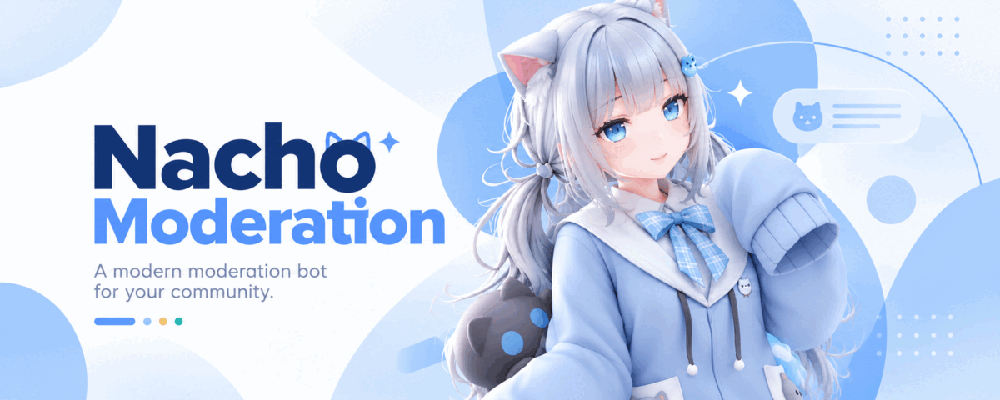
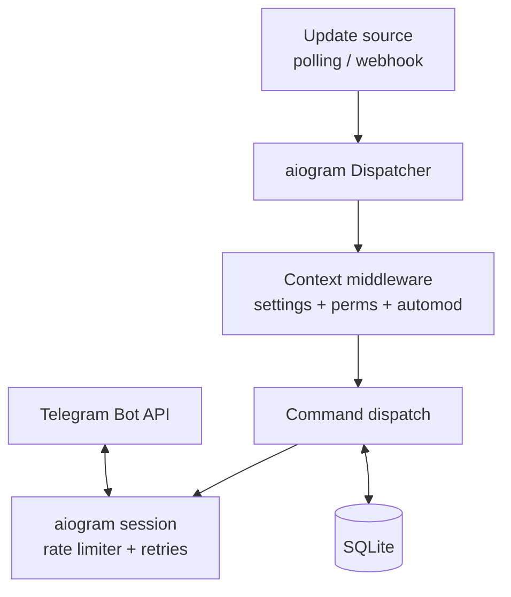

# nacho-moderator

[](https://github.com/cuwayo/nacho-moderation/actions/workflows/ci.yml)
[](https://www.python.org/downloads/)
[](https://github.com/astral-sh/uv)
[](LICENSE)



An **asyncio Telegram admin/moderator bot** written in **Python 3.12**, built on
[aiogram 3](https://docs.aiogram.dev) and managed with [uv](https://docs.astral.sh/uv/).

## Features

- Moderation commands: `/ban`, `/unban`, `/kick`, `/mute`, `/unmute`, `/del`,
  `/pin`, `/unpin`, `/purge`, with `30s`/`10m`/`2h`/`7d`/`1w` durations.
- Warnings: `/warn`, `/unwarn`, `/warns`, `/resetwarns`, with a per-chat limit and
  auto-action (`ban`/`mute`/`kick`).
- Per-chat settings: `/setwarnlimit`, `/setwarnaction`, `/setlog`, `/reload`, and
  an inline-keyboard `/settings` panel.
- Welcome and rules: `/setwelcome`, `/welcome on|off`, `/setrules`, `/rules`, with
  a join welcome rendered from `{first}`/`{mention}`/`{chat}`/`{count}`.
- A moderation log that mirrors every action to a configured channel.
- Temporary bans and mutes that survive a restart and lift automatically.
- Join captcha, antiflood, and word/regex blacklist automod.
- Fully asynchronous I/O on one event loop; pooled, rate-limited Bot API calls
  with retries.
- `getUpdates` long-polling **or** webhook mode behind a TLS-terminating proxy.
- SQLite persistence with migrations, on `aiosqlite`.
- Graceful shutdown with a bounded drain of in-flight updates.

## How it works



Updates arrive by long-polling or webhook, both feeding one aiogram dispatcher.
Every group message passes through a middleware that resolves the chat's settings
and administrators and runs automod (locks, blacklist, antiflood) before command
dispatch. All outbound calls go through a session middleware that enforces the
Bot API rate limits and retry policy. See [`docs/architecture.md`](docs/architecture.md).

## Requirements

- Python 3.12.
- [uv](https://docs.astral.sh/uv/) (provisions Python 3.12 if needed).

## Quick start

```sh title="ci"
uv sync
uv run pytest
```

Create a bot with [@BotFather](https://t.me/BotFather) and note its token, then:

```sh
cp config/config.example.toml config.toml
chmod 600 config.toml   # the file holds the bot token; the bot refuses a group/other-readable secret
# edit config.toml and set bot_token
uv run nacho-moderator --config config.toml
```

In containers or CI, where a baked-in config file is often world-readable, pass
`--allow-insecure-config` (or set `ALLOW_INSECURE_CONFIG=1`) to skip the
permission check. See [`docs/configuration.md`](docs/configuration.md).

Add the bot to a group, grant it the administrator rights you want it to use, and
verify with `/help`.

## Configuration

The most important keys (full reference in
[`docs/configuration.md`](docs/configuration.md)):

| Key | Default | Description |
| --- | --- | --- |
| `bot_token` | *(required)* | BotFather token; never logged. |
| `mode` | `polling` | `polling` or `webhook`. |
| `db.path` | `./bot.db` | SQLite database file. |
| `api.base` | `https://api.telegram.org` | Bot API base URL. |
| `log.level` | `info` | `error`, `warn`, `info`, or `debug`. |

## Commands

See [`docs/commands.md`](docs/commands.md) for the full reference.

| Command | Role | Description |
| --- | --- | --- |
| `/help` | anyone | Show available commands. |
| `/ban` `/unban` `/kick` `/mute` `/unmute` | admin | Moderation. |
| `/del` `/pin` `/unpin` `/purge` | admin | Message management. |
| `/warn` `/unwarn` `/warns` `/resetwarns` | admin / anyone | Warnings. |
| `/settings` `/setwelcome` `/welcome` `/setrules` `/rules` `/reload` | admin | Settings. |
| `/setlog` | owner | Moderation log channel. |
| `/lock` `/unlock` `/blacklist` `/antiflood` `/captcha` | admin | Automod. |

## Deployment

```sh
sudo install -m 0644 packaging/nachomoderator.service /etc/systemd/system/
sudo systemctl enable --now nachomoderator.service
```

Docker and webhook setup are covered in [`docs/deployment.md`](docs/deployment.md).

## Development

```sh
uv sync
uv run ruff check .          # lint
uv run mypy src              # type-check
uv run pytest --cov          # tests + coverage
```

See [`docs/testing.md`](docs/testing.md) and [`CONTRIBUTING.md`](CONTRIBUTING.md).

## Project layout

```text
src/nacho_moderator/   the bot package
  commands/            the command registry and handlers
  services/            perms, settings, automod, captcha, expiry, welcome
  transport/           rate limiting and retries
  db/                  SQLite schema, migrations, repositories
tests/                 unit tests, a fake bot, and a mock API server
docs/                  prose documentation
packaging/             systemd unit and Dockerfile
```

## Troubleshooting

See [`docs/troubleshooting.md`](docs/troubleshooting.md). Top issues: the bot
lacks a required admin right, webhook secret mismatch, `chat_member` updates not
delivered because the bot is not an administrator, and HTTP 429 floods.

## Security

The token is read from config or environment and redacted from logs. Webhook
updates are authenticated with a constant-time secret check. See
[`SECURITY.md`](SECURITY.md).

## License

GPL-3.0-or-later. See [`LICENSE`](LICENSE).

## Acknowledgements

Built on [aiogram](https://github.com/aiogram/aiogram) and packaged with
[uv](https://github.com/astral-sh/uv).
