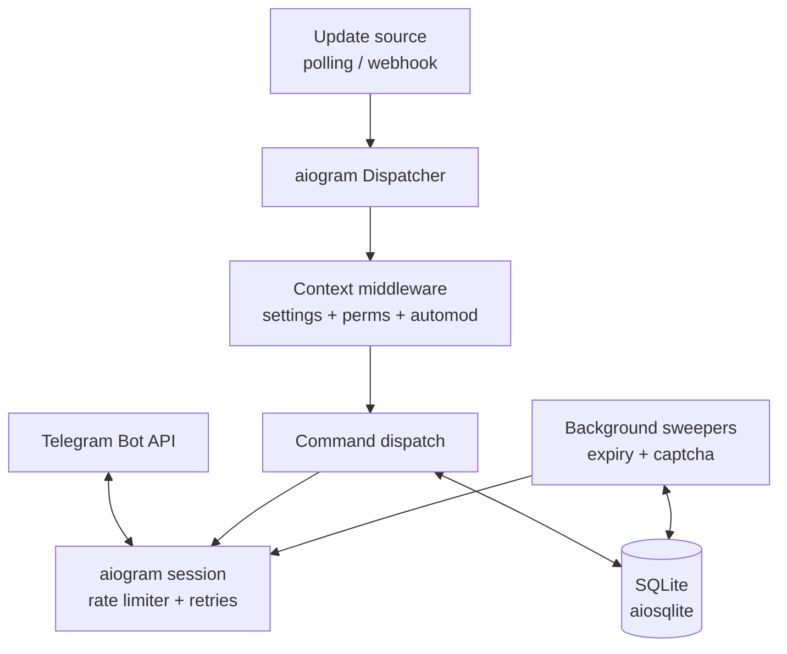

# SPEC: Telegram group admin/moderator bot (Python + asyncio + aiogram)

- **Status:** Current. This supersedes the original C/`liburing` specification;
  the C implementation is preserved at the `c-implementation-final` tag (see
  [`adr/0001-python-asyncio-aiogram.md`](adr/0001-python-asyncio-aiogram.md)).
- **Stack:** Python 3.12, `asyncio`, [aiogram 3](https://docs.aiogram.dev),
  `aiosqlite`, [`regex`](https://pypi.org/project/regex/), managed with `uv`.

## 1. Goal

A Telegram bot that moderates and manages groups and supergroups: member
moderation, warnings, per-chat settings, join verification, automated moderation,
and a moderation log. It runs as a single asyncio process with one event loop.

## 2. Non-goals

- No GUI or web dashboard.
- No ML-based spam detection.
- No multi-process clustering; the process scales later by sharding on `chat_id`.
- No non-Linux guarantee; the deployment target is Linux.

## 3. Tech stack and constraints

| Concern | Decision |
| --- | --- |
| Language | Python 3.12 (`requires-python = ">=3.12,<3.13"`). |
| Concurrency | One asyncio event loop; no threads except those the libraries own (`aiosqlite`, the TLS/HTTP stack). |
| Bot framework | aiogram 3: `Dispatcher`, routers, middlewares. |
| HTTP / TLS | `aiohttp` through aiogram's `AiohttpSession`; a plain `http://` `api.base` skips TLS for local/self-hosted use. |
| Storage | SQLite via `aiosqlite` (WAL). Each query runs on the driver's thread and returns to the loop, so the loop is never blocked. |
| Regex | the `regex` module, compiled with a match time limit so a hostile pattern cannot stall the loop. |
| Config | `config.toml` (TOML) plus environment variables and CLI flags. |
| Logging | Structured line logs to stderr; the token and webhook secret are redacted from the final rendered line. |
| Dependencies | `aiogram`, `aiosqlite`, `regex`. No others without a decision. |

## 4. Architecture



One asyncio event loop. Updates arrive by long-polling or webhook, both feeding
the same aiogram `Dispatcher`. All outbound Bot API calls pass through a session
middleware that enforces the rate limits and retry policy. SQLite is accessed
through `aiosqlite`. Background sweepers lift expired bans/mutes and kick
members whose captcha deadline passed.

### 4.1 Update source (`mode`)

1. **`polling`** (default): long-poll `getUpdates` (`polling.timeout`, default
   30 s) with an explicit `allowed_updates` set. The offset advances as
   `last_update_id + 1`.
2. **`webhook`**: an `aiohttp` listener on `webhook.listen` behind a
   TLS-terminating reverse proxy. Every request must carry an
   `X-Telegram-Bot-Api-Secret-Token` header equal to `webhook.secret`; a mismatch
   is answered with **403**.

`allowed_updates`: `message`, `edited_message`, `callback_query`, `chat_member`,
`my_chat_member`.

### 4.2 Bot API client

- One `AiohttpSession` with a connection pool (`api.pool_size`, default 4),
  keep-alive, and a per-request timeout (`api.request_timeout_ms`).
- Outbound **token-bucket rate limiter**: global **25 req/s**, per-chat messages
  **15 req/min**, per-chat bulk **1 req/s**. Excess requests are queued, never
  dropped.
- On HTTP **429**: read `parameters.retry_after`, pause the affected bucket for
  that many seconds, then retry.
- On 5xx or a network error: retry idempotent methods with a backoff of **1, 2,
  4, 8, 16, then 30 seconds**, up to **5 retries**. Non-429 4xx errors are never
  retried.

### 4.3 Transport layer

| Module | Responsibility |
| --- | --- |
| `transport/buckets` | Token buckets (global / per-chat / bulk) over the injectable clock. |
| `transport/retry` | Idempotency map and the backoff schedule. |
| `transport/ratelimit` | The aiogram session middleware tying them together. |

### 4.4 Database

SQLite in WAL mode with `busy_timeout`; a `schema_version`-driven migration
runner applies `db/schema.sql`. Hot data (admin list, per-chat settings, flood
counters) lives in TTL caches in front of the database; the database is the
source of truth for warnings, actions, settings, blacklist, and pending captchas.

### 4.5 Metrics

Handler latency and event-loop lag are recorded in bounded histograms and dumped
as one `soak-metrics` line on `SIGUSR1` and at shutdown, so the soak test can
gate on them (see [`adr/0002-python-loop-lag-budget.md`](adr/0002-python-loop-lag-budget.md)).

## 5. Features

### 5.1 Permission model

- Roles: `OWNER` (Telegram creator), `ADMIN`, `ANYONE` (member), plus bot-level
  `SUDO` users from `sudo_ids`.
- The administrator list comes from `getChatAdministrators`, cached for **10
  minutes** and invalidated on any `chat_member`/`my_chat_member` update or on
  `/reload`. Concurrent lookups for one chat share a single in-flight fetch.
- Each command declares a required role, a caller right, and a bot right. The
  bot's right is checked first; owner and sudo bypass the caller check.
- The owner, other administrators, and the bot itself are never acted upon,
  except that `/demote` (flagged `ADMIN_TARGET`) may act on an administrator —
  but still never on the owner or the bot.

### 5.2 Commands

Target resolution order: the replied-to message's sender, then a numeric user id,
then an `@username` (resolved against the chat's administrators and the users
cache). An optional duration suffix is `30s`, `10m`, `2h`, `7d`, or `1w`; without
one the action is permanent. Optional trailing text is the reason.

The full command table (31 commands), declared once in
`commands/registry.py`:

| Command | Usage | Role | Right | Description |
| --- | --- | --- | --- | --- |
| `/help` | | anyone | | Show available commands. |
| `/start` | | anyone | | Same text as `/help`; works in private chats. |
| `/ban` | `[target] [duration] [reason]` | admin | restrict | Ban a user. |
| `/unban` | `[target]` | admin | restrict | Lift a ban. |
| `/kick` | `[target] [reason]` | admin | restrict | Remove so they can rejoin. |
| `/mute` | `[target] [duration] [reason]` | admin | restrict | Restrict sending. |
| `/unmute` | `[target]` | admin | restrict | Restore permissions. |
| `/promote` | `[target] [title]` | admin | promote | Grant limited rights. |
| `/demote` | `[target]` | admin | promote | Remove admin rights. |
| `/del` | *(reply)* | admin | delete | Delete the replied-to message and the command. |
| `/pin` | *(reply)* | admin | pin | Pin the replied-to message. |
| `/unpin` | | admin | pin | Unpin the last pinned message. |
| `/purge` | *(reply)* | admin | delete | Delete from the replied message to the command. |
| `/warn` | `[target] [reason]` | admin | restrict | Warn; auto-act at the limit. |
| `/unwarn` | `[target]` | admin | restrict | Remove the newest warning. |
| `/warns` | `[target]` | anyone | | List your warnings, or a user's (admins). |
| `/resetwarns` | `[target]` | admin | restrict | Clear all warnings. |
| `/setwarnlimit` | `<n>` | admin | restrict | Warnings before the action fires. |
| `/setwarnaction` | `ban\|mute\|kick` | admin | restrict | Action at the limit. |
| `/setlog` | `<chat_id\|off>` | owner | | Set or clear the log channel. |
| `/reload` | | admin | | Refresh the cached admin list. |
| `/settings` | | admin | change_info | Open the inline settings panel. |
| `/setwelcome` | `<text>` | admin | change_info | Set the join welcome. |
| `/welcome` | `on\|off` | admin | change_info | Enable/disable the join welcome. |
| `/setrules` | `<text>` | admin | change_info | Set the chat rules. |
| `/rules` | | anyone | | Show the chat rules. |
| `/lock` | `<type> [type...]` | admin | delete | Lock a message type. |
| `/unlock` | `<type> [type...]` | admin | delete | Unlock a message type. |
| `/blacklist` | `add\|del\|list <word\|/regex/>` | admin | delete | Manage the word/regex blacklist. |
| `/antiflood` | `<messages> <seconds>\|off` | admin | restrict | Set the flood threshold. |
| `/captcha` | `on\|off` | admin | restrict | Enable/disable join verification. |

`setMyCommands` is registered for two scopes: `all_group_chats` (non-admin,
non-hidden commands) and `all_chat_administrators` (every non-hidden command).
The administrator scope is a superset of the group scope.

**`/promote` and `/demote`.** `/promote` grants only `can_delete_messages`,
`can_restrict_members`, and `can_pin_messages`, and never `can_promote_members`,
`can_change_info`, or `can_manage_chat`. An optional custom title is trimmed to
Telegram's limit of 16 characters and HTML-escaped when echoed. `/demote` clears
every right; it refuses the owner and the bot, and reports (without retrying)
Telegram's rejection of an administrator the bot did not promote.

### 5.3 Automated moderation

Every group message runs through automod **before** command dispatch, in the
order **locks -> blacklist -> antiflood**. Administrators, the owner, and sudo
users are exempt. Bots are skipped unless the `bots` lock is set.

1. **Locks** — a per-chat bitmask (`chats.locks`) of `links`, `media`,
   `stickers`, `forwards`, `polls`, `invites`, `bots`, `commands`. A locked
   message is deleted and logged.
2. **Blacklist** — word and `/regex/` patterns matched case-insensitively over
   the text or caption. A match deletes the message and warns the sender,
   applying the configured warn action at the limit. Regexes are compiled with a
   match time limit so a hostile pattern cannot stall the loop.
3. **Antiflood** — a sliding window per `(chat_id, user_id)`. Exceeding the
   threshold mutes the sender (a temporary restriction the expiry sweeper lifts)
   and deletes the burst.

### 5.4 Join / captcha flow

Handled for both `chat_member` and `message.new_chat_members`. If
`captcha_enabled`, the new member is immediately restricted (no send), sent an
inline "I'm human" button, and recorded in `pending_captcha` with a deadline
(default `captcha_timeout` = 120 s). A press by the correct user lifts the
restriction, deletes the prompt, and delivers the welcome; a press by anyone else
is rejected; a passed deadline kicks the member (ban then unban). Callback data
is `cap:<chat_id>:<user_id>:<nonce>` and must be **≤ 64 bytes**.

### 5.5 Moderation log

Every moderation action writes an `actions` row and, when `log_chat_id` is set,
posts action, target, admin, reason, and duration to the log channel.

### 5.6 Expiring actions

Temporary bans and mutes are stored in `actions` with an absolute wall-clock
`expires_at`. A background task sweeps every **30 seconds** and lifts due rows
(`unbanChatMember(only_if_banned=True)` / restored permissions), marking each
lifted. A permanent action stores `expires_at = NULL` and is never swept. Because
the deadline is absolute, this **survives a restart**.

## 6. Data model (SQLite)

See [`../src/nacho_moderator/db/schema.sql`](../src/nacho_moderator/db/schema.sql):
`chats`, `users` (indexed by username), `warns`, `actions` (partial index on
`expires_at` where not lifted), `blacklist`, `pending_captcha`, and
`schema_version`. A migration runner keyed on `schema_version` applies changes.

## 7. Configuration

Four sources, highest precedence first: CLI flags, environment variables,
`config.toml`, built-in defaults. Full reference in
[`configuration.md`](configuration.md). Keys: `bot_token` (required, never
logged), `mode`, `sudo_ids`, `webhook.listen`, `webhook.secret`, `db.path`,
`api.pool_size`, `api.base`, `api.request_timeout_ms`, `polling.timeout`,
`log.level`. A config file holding a secret must be mode `0600` (or
`--allow-insecure-config`).

## 8. Source layout

```text
src/nacho_moderator/
  main.py            entry point, wiring, polling/webhook, graceful shutdown
  config.py          config loading, validation, precedence
  logging_setup.py   structured logging with redaction
  metrics.py         handler-latency and loop-lag histograms
  clock.py           injectable clock and random source
  models.py          duration parsing, HTML escaping, target references
  router.py          command parsing, target resolution, permission gating
  handlers.py        aiogram wiring: middleware, dispatch, joins, callbacks
  webhook.py         the aiohttp app and the secret check
  constants.py       roles, rights, flags, limits, defaults
  db/                schema, migrations, typed repositories
  commands/          the registry and one module per command group
  services/          perms, settings, automod, captcha, expiry, welcome
  transport/         rate limiting and retries
tests/               unit, integration, and a mock Bot API server
docs/                prose documentation and ADRs
```

## 9. Error handling and shutdown

- Handlers never block the loop; multi-step flows (`/kick` = ban then unban)
  await their steps.
- All Telegram text is sent with `parse_mode=HTML` and user input is
  HTML-escaped (`&`, `<`, `>`); only the trusted `{mention}` placeholder is sent
  unescaped.
- Graceful shutdown on `SIGINT`/`SIGTERM`: the update source stops, in-flight
  updates drain for up to **10 seconds**, then the database and session close.

## 10. Security

- The token and webhook secret are redacted from logs and diagnostic output, on
  the final rendered line, including tracebacks and the `aiogram`/`aiohttp`/
  `asyncio` loggers.
- The webhook secret is verified before any update is processed; a mismatch is
  rejected with **403**, and the bot refuses to start in webhook mode without a
  secret of at least 16 characters.
- A secret-bearing config file must not be group/other accessible.
- Admin commands are unavailable in private chats (except `/help` and `/start`).
- Callback payloads embed the owning user id and are rejected when pressed by
  anyone else.
- Every SQL query uses bound parameters; no SQL is built by string concatenation.
- Blacklist regexes are matched with a time limit so a hostile pattern cannot
  stall the event loop.

## 11. Testing and acceptance criteria

**Unit tests** (no network): duration parser, command/target/argument parser,
callback parser, HTML escaping, token buckets, retry policy, flood window,
permission matrix, admin cache, automod, captcha, expiry, config, log redaction.
**Integration tests**: the real bot process driven against the mock Bot API
server over plain HTTP, asserting the outbound calls.
**Soak test**: 30 s smoke on every PR, 600 s nightly (see
[`testing.md`](testing.md) and [`adr/0002-python-loop-lag-budget.md`](adr/0002-python-loop-lag-budget.md)).

Acceptance:

1. 1,000 updates/s replayed against the mock server with **p99 handler latency
   < 50 ms** and **event-loop lag < 100 ms**, and no traceback or un-awaited-task
   warning.
2. No token or secret appears in any log path (property test with randomized
   seeds).
3. `/ban 10m` auto-unbans after a restart of the bot process.
4. 429 responses are honoured (no request is sent to a throttled bucket before
   `retry_after`).
5. A non-administrator cannot execute any admin command; a bot without the
   required right replies with a clear error.
6. The captcha timeout kicks the user and cleans up the message and the DB row.
7. `ruff`, `mypy --strict`, and `pytest` (with coverage floors) all pass.

## 12. Historical milestones (C implementation)

The C implementation was built in milestones M0–M7 (io_uring loop; HTTP client
and polling; update parsing, router, DB worker, permissions; moderation commands;
warns/settings/welcome; automod and captcha; webhook, shutdown, packaging). Those
milestones are retained in git history and in the `c-implementation-final` tag;
this Python port replaces them. See the [CHANGELOG](../CHANGELOG.md) for the port.
