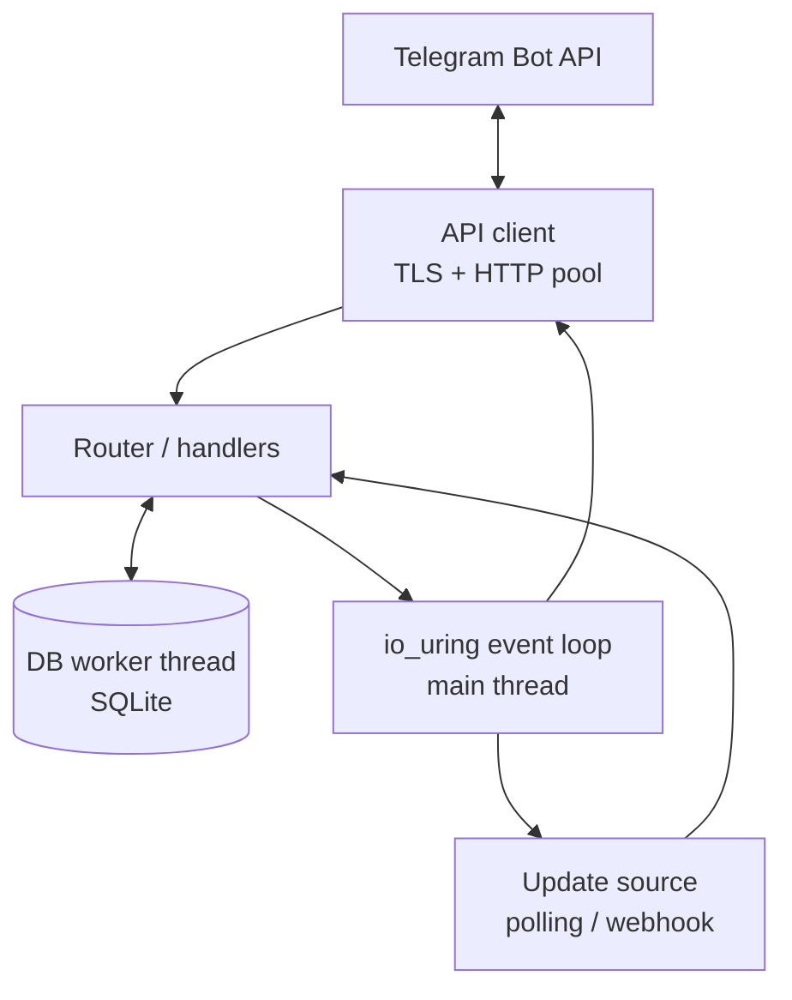
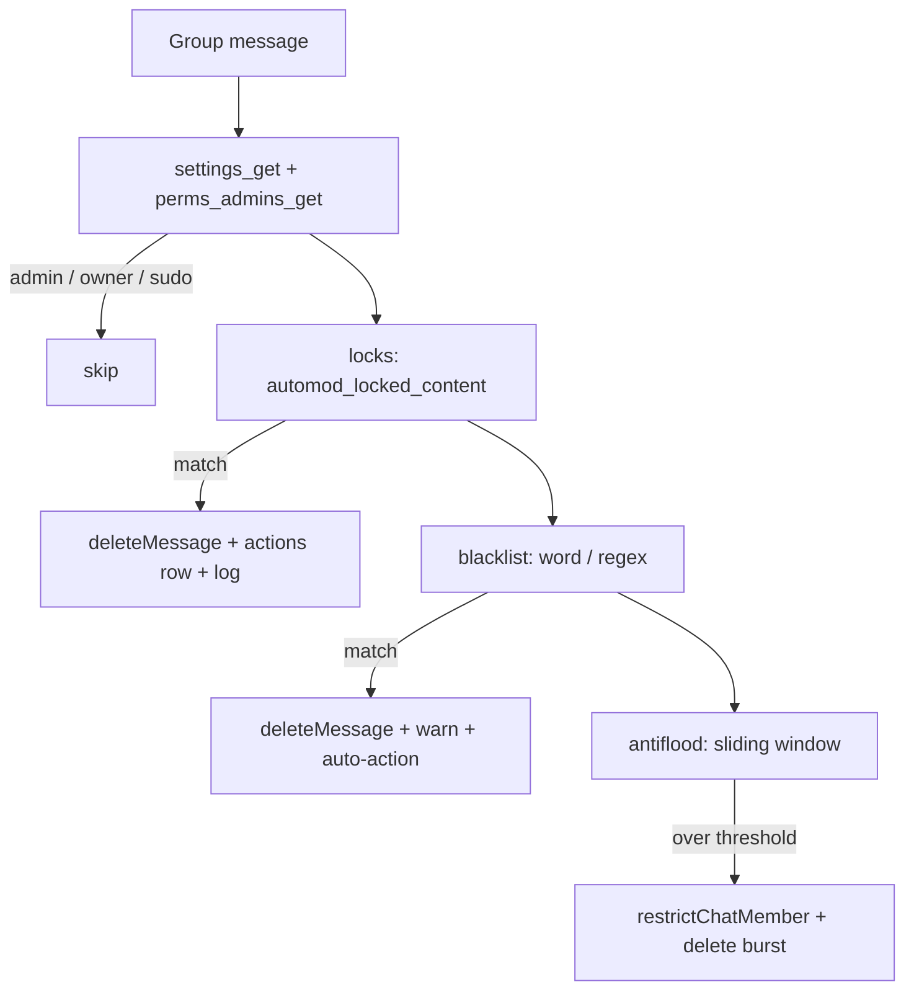
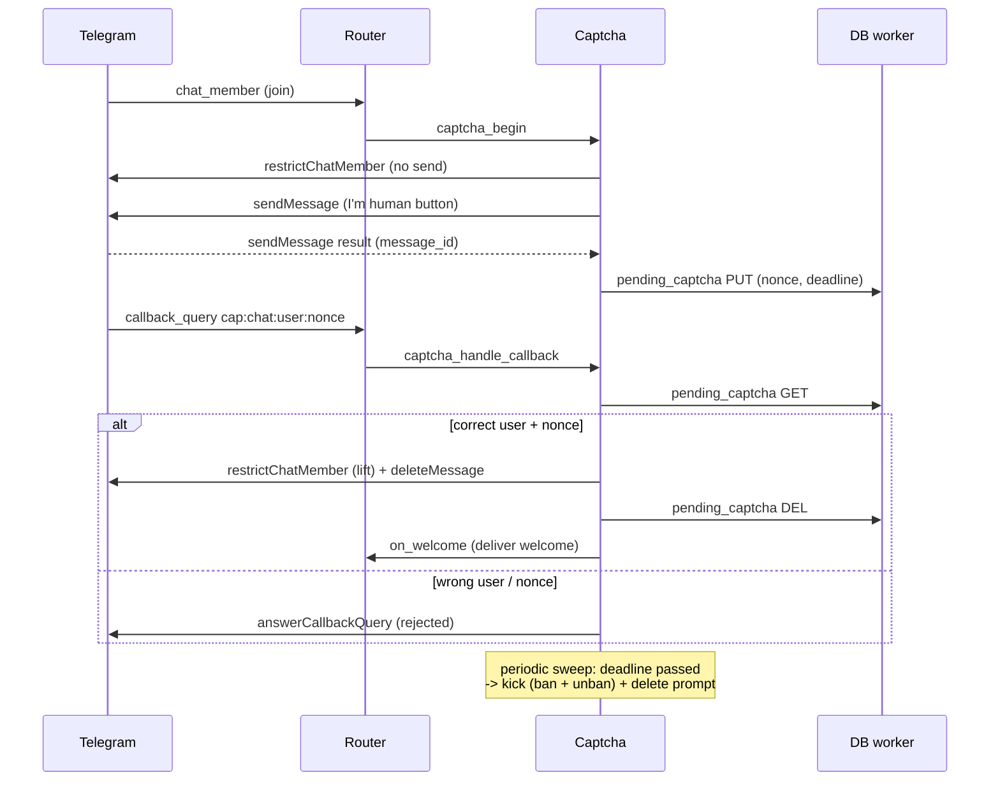

# Architecture

This document describes how nacho-moderator is structured. It is expanded as the
implementation progresses; the binding rules live in [`SPEC.md`](SPEC.md).

> **Implemented in M1:** the event loop (`src/loop.c`), TCP connection state
> machine (`src/net_conn.c`), OpenSSL memory-BIO TLS adapter (`src/tls.c`),
> incremental HTTP client (`src/http.c`), worker-thread DNS resolver
> (`src/resolver.c`), a minimal Bot API client (`src/tg_api.c`), and the
> utilities (`src/util.c`). The router, DB worker, commands, and automod arrive in
> M3–M6.
>
> **Implemented in M2:** reusable keep-alive connections (`conn_keep_alive` /
> `conn_reuse_begin` in `src/net_conn.c`), the outbound rate limiter
> (`src/rate_limit.c`), the retry policy (`src/api_retry.c`), the connection pool
> (`src/api_pool.c`), the API client facade (`src/tg_api.c`), the API method table
> (`src/api_methods.c`), runtime counters (`src/metrics.c`), and the `getUpdates`
> long-poll loop (`src/polling.c`).
>
> **Implemented in M3:** update parsing (`src/tg_types.c`), the command router
> (`src/router.c`), the SQLite worker thread with `users`/`chats` upserts
> (`src/db.c`), the TTL cache (`src/cache.c`), the permission model and admin cache
> (`src/perms.c`), and a real `/help` reply rendered from the command table
> (`src/commands.c`, `src/cmd_help.c`). Remaining command groups and automod arrive
> in M4–M6.
>
> **Implemented in M4:** the moderation commands `/ban /unban /kick /mute /unmute`
> (`src/cmd_mod.c`) and `/del /pin /unpin /purge` (`src/cmd_msg.c`), shared argument
> parsing and target guards (`src/cmd_util.c`), the reference-counted command
> invocation (`src/cmd_ctx.c`), the injectable wall clock (`src/util.c`), and the
> expiring-actions sweeper (`src/expiry.c`). The router now resolves targets
> (`@username` via the `users` cache) and derives caller/target/bot roles from one
> `getChatAdministrators` fetch.
>
> **Implemented in M5:** the warning commands `/warn /unwarn /warns /resetwarns`
> (`src/cmd_warn.c`), the settings/welcome/rules/reload commands and the
> `/settings` inline-keyboard panel (`src/cmd_settings.c`), the per-chat settings
> service with a TTL cache (`src/settings.c`), join-time welcome delivery, the
> moderation log, and inline-keyboard callback routing (`src/router.c`).
>
> **Implemented in M6:** automated moderation (`src/automod.c`) — locks, the
> word/regex blacklist and antiflood, run on every group message before command
> dispatch in the SPEC section 5.3 order; join verification (`src/captcha.c`) with
> an inline "I'm human" button and a timeout sweep; the automod configuration
> commands `/lock /unlock /blacklist /antiflood /captcha` (`src/cmd_automod.c`); a
> message classifier in `src/tg_types.c`; and an injectable random source in
> `src/util.c`.

## Module map (M1–M6)

| Module | Responsibility |
|---|---|
| `loop` | Ring setup with feature probing, SQE prep helpers, one submit per iteration, CQE dispatch by `op_t` type |
| `net_conn` | connect → TLS handshake → HTTP write → HTTP read state machine; keep-alive reuse |
| `tls` | `BIO_s_mem` pump; ciphertext moved by io_uring recv/send, never blocking `SSL_read`/`SSL_write` on a socket |
| `http` | Request builders (GET/POST) and byte-at-a-time response parser (Content-Length, chunked, keep-alive) |
| `resolver` | `getaddrinfo` on a worker thread, handed to the loop via `eventfd` |
| `api_methods` | X-macro view of `api_methods.def`: names, buckets, idempotency |
| `rate_limit` | Token buckets (global 25/s, per-chat 15/min, bulk 1/s) with an injectable clock and 429 pause |
| `api_retry` | Retry decision (idempotency, backoff, deadline) |
| `api_pool` | Keep-alive connection pool, request queue, rate-limit gating, retries, dispatch timer |
| `tg_api` | API client facade, method wrappers, JSON parsing, injectable `tg_api_ops_t` seam |
| `polling` | `getUpdates` long-poll loop and offset tracking |
| `tg_types` | Parse `getUpdates` batches into bounded Update/Message/User/Chat structs, with entities and content flags |
| `router` | Parse `/command`, resolve target (reply / numeric / `@username`), fetch the admin list, check permissions, run automod, dispatch handlers |
| `automod` | Locks, blacklist and antiflood over every group message (SPEC section 5.3); an injectable clock drives the flood window |
| `captcha` | Join verification: restrict + prompt + timeout sweep (SPEC section 5.4) |
| `cmd_ctx` | Reference-counted command invocation; reply and action-recording hooks |
| `cmd_*` | One handler per command; build the API body, issue it, reply |
| `cmd_util` | Shared `[duration] [reason]` parsing and the target guard |
| `settings` | Per-chat policy TTL cache over the DB worker (warns/welcome/rules/log/automod) |
| `expiry` | 30 s sweeper that lifts expired temp bans/mutes (SPEC section 5.6) |
| `db` | SQLite worker thread, MPSC job queue, migrations, upserts, actions, blacklist, captcha, eventfd handoff |
| `cache` | In-memory hash map with TTL (admin cache, flood windows, blacklist, other hot data) |
| `perms` | Role/right checks and the per-chat administrator cache |
| `commands` | Command table (`commands.def`), lookup, `/help` rendering, `setMyCommands` |
| `metrics` | Runtime counters (SIGUSR1 dump) |
| `util` | Arena allocator, string builder, duration parser, HTML escape, injectable clock/random, logger |

## Component overview

The main thread runs a single-threaded `io_uring` event loop. All socket, timer,
and `eventfd` operations are submitted as SQEs and completed as CQEs dispatched by
`op_t` type. Blocking work (SQLite, DNS) runs on worker threads that signal the
loop through an `eventfd`.

## Thread model

| Thread | Owns | Notes |
|---|---|---|
| Main | io_uring ring, connection state machines, router, permission engine, admin cache | Never blocks (see below) |
| DB worker | SQLite connection and prepared statements; the job and response queues | Woken via `cond`; signals the loop via `eventfd` read through io_uring |
| DNS worker | `getaddrinfo` result at startup and refresh | Signalled via `eventfd` |

### DB worker handoff (M3)

The loop thread only ever touches the DB job/response queues (under a mutex) and
the eventfd; SQLite and its prepared statements belong exclusively to the worker.
`db_arm()` prepares one `OP_EVENTFD` read at startup. When a job completes the
worker appends to the response queue and writes the eventfd; the read's completion
runs `db_pump()` (which fires the callbacks on the loop thread) and re-arms the
next read. This is the same worker-thread + eventfd pattern as `resolver`, and it
keeps the main thread free of any SQLite or file syscall (ADR 0003).

## Automated moderation (M6)

Every group message runs through `automod_handle_message()` **before** command
dispatch, in the order the SPEC fixes (section 5.3):

The lock classifier and the flood-window arithmetic are pure and unit-tested; the
antiflood window lives in memory (per `chat_id:user_id`) and is advanced by the
injected monotonic clock, so tests are deterministic. A blacklist regex is
compiled with PCRE2 under match/depth limits so a hostile pattern cannot stall the
loop (SPEC section 10).

## Join captcha (M6)

## Error-handling policy

Error classes are defined once in `src/errors.def`. The table below is generated
from that file by `scripts/docgen.py`.

<!-- BEGIN GENERATED: error-classes -->
| Class | Code | Log level | Retry | Description |
|---|---|---|---|---|
| INVAL | -22 | LOG_ERROR | no | Invalid argument or malformed input |
| NOMEM | -12 | LOG_ERROR | no | Out of memory |
| NET | -101 | LOG_WARN | yes | Network failure (connect, reset, timeout) |
| TLS | -102 | LOG_ERROR | no | TLS handshake or certificate verification failure |
| HTTP | -103 | LOG_WARN | yes | Unexpected HTTP status from the Bot API |
| TG_API | -104 | LOG_WARN | no | Bot API returned ok=false with a description |
| RATE_LIMIT | -105 | LOG_INFO | yes | HTTP 429; honour retry_after before retrying |
| DB | -106 | LOG_ERROR | no | Database error from the DB worker |
| PARSE | -107 | LOG_WARN | no | JSON or response parsing failure |
| PROTO | -108 | LOG_ERROR | no | Protocol violation (bad HTTP, oversized body) |
| PERM | -109 | LOG_INFO | no | Caller or bot lacks the required permission |
<!-- END GENERATED: error-classes -->

## Non-blocking rule

The main thread must never issue blocking `read`, `connect`, `poll`, `futex` wait,
or any SQLite/file I/O. `scripts/check_blocking.sh` verifies this with `strace`
(see [`io_uring-notes.md`](io_uring-notes.md)).
