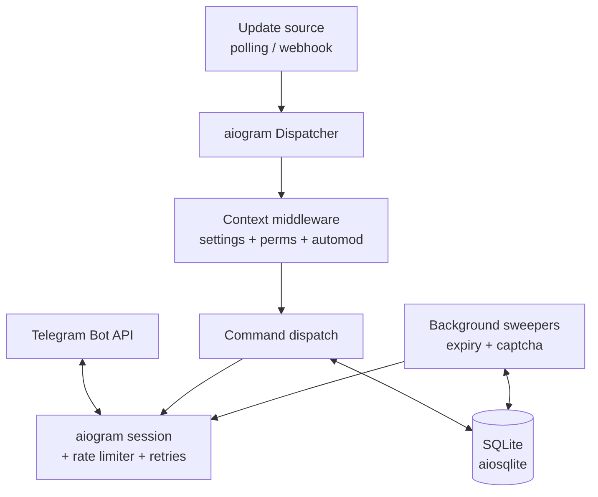
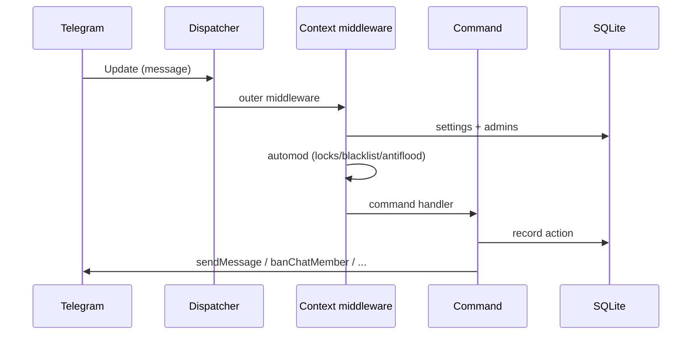

# Architecture

nacho-moderator is a single-process asyncio Telegram bot built on
[aiogram 3](https://docs.aiogram.dev). This document describes how it is put
together.

## Components

The process runs one asyncio event loop. Updates arrive either by long-polling
(`getUpdates`) or through an aiohttp webhook listener, both feeding the same
aiogram `Dispatcher`. All outbound Bot API calls pass through a custom session
middleware that enforces the rate limits and retry policy. SQLite is accessed
through `aiosqlite`, which runs each query on its own thread and hands the
result back to the event loop, so the loop is never blocked.

## Module map

| Module | Responsibility |
| --- | --- |
| `config` | Load and validate `config.toml`, environment, and CLI overrides. |
| `logging_setup` | Structured stderr logging; redacts the token and secrets from the final rendered line. |
| `clock` | Injectable wall-clock/monotonic clock and random source. |
| `models` | Duration parsing, HTML escaping, target references. |
| `db` | SQLite schema, migrations, and typed repositories. |
| `services/perms` | Administrator cache (10-minute TTL) and role/right resolution. |
| `services/settings` | Per-chat policy cache over the database. |
| `services/automod` | Locks, blacklist, and antiflood over group messages. |
| `services/captcha` | Join verification: restrict, prompt, verify, expire. |
| `services/expiry` | Periodic lifting of expired temp bans/mutes; captcha sweep. |
| `services/welcome` | `{first}`/`{mention}`/`{chat}`/`{count}` rendering. |
| `transport/buckets` | Token buckets: global 25/s, per-chat 15/min, bulk 1/s. |
| `transport/retry` | Idempotency map and the backoff schedule. |
| `transport/ratelimit` | The aiogram session middleware that ties them together. |
| `commands/registry` | The single command table that drives `/help` and `setMyCommands`. |
| `commands/*` | One module per command group; the handlers. |
| `router` | Command parsing, target resolution, and permission gating. |
| `handlers` | aiogram wiring: middleware, dispatch, joins, callbacks. |
| `metrics` | Handler-latency and event-loop-lag histograms; SIGUSR1 dump for the soak test. |
| `webhook` | The aiohttp app and the secret check. |
| `main` | Entry point: config, wiring, polling/webhook, graceful shutdown. |

## Update flow

Every group message passes through the context middleware before dispatch. The
middleware resolves the chat's settings and administrator list once, then runs
automod. Administrators, the owner, and sudo users are exempt from automod;
commands are dispatched by the command handler rather than being scanned. When
automod decides to delete or mute, it stops propagation so the command handler
never runs.

## Permission model

A caller's role is one of `ANYONE`, `ADMIN`, `OWNER`, or `SUDO`. The
administrator list comes from `getChatAdministrators`, cached for 10 minutes and
invalidated on any `chat_member`/`my_chat_member` update or `/reload`. Each
command declares the role it needs, a caller right, and a bot right; the bot's
right is checked first, then owner and sudo bypass the caller check.

## Rate limiting and retries

Outbound calls are shaped by three token buckets:

- global: 25 requests/second;
- per-chat messages: 15 requests/minute (`sendMessage`, `editMessageText`);
- per-chat bulk: 1 request/second (bans, deletes, pins, ...).

A request waits for a token in both the global bucket and its class bucket;
requests are queued, never dropped. On HTTP 429 the affected bucket is paused for
`retry_after` seconds. On a 5xx or network error, idempotent methods are retried
with a backoff of 1, 2, 4, 8, 16, then 30 seconds, up to five retries. Non-429
4xx errors are never retried.

## Expiring actions

Temporary bans and mutes are stored in the `actions` table with an absolute
wall-clock `expires_at`. A background task sweeps every 30 seconds and lifts the
due rows: a ban becomes `unbanChatMember(only_if_banned=True)`, a mute restores
the common group permissions, and the row is marked lifted. Because the deadline
is absolute, this survives a restart.

## Graceful shutdown

On `SIGINT`/`SIGTERM` the bot stops the update source, drains in-flight updates
for up to 10 seconds, closes the database, and closes the Bot API session.
