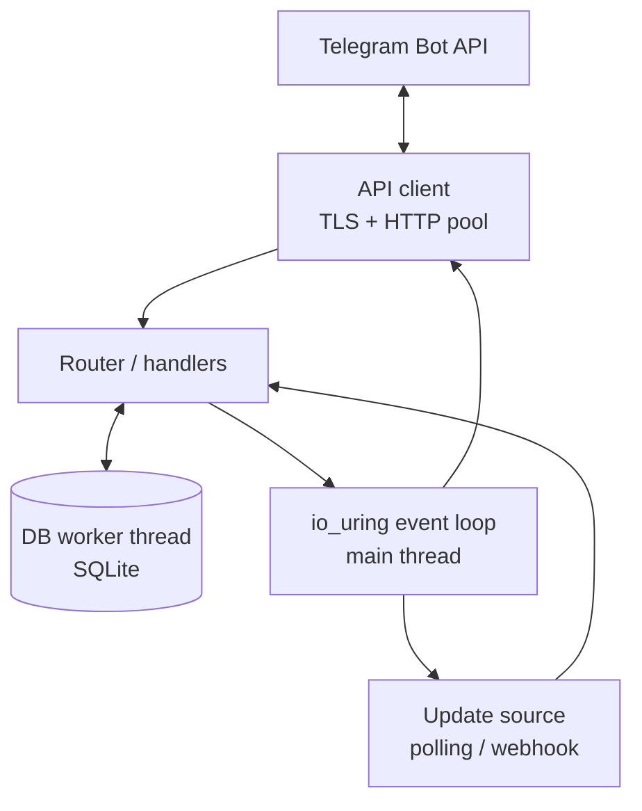

# Architecture

This document describes how nacho-moderator is structured. It is expanded as the
implementation progresses; the binding rules live in [`SPEC.md`](SPEC.md).

> **Implemented in M1:** the event loop (`src/loop.c`), TCP connection state
> machine (`src/net_conn.c`), OpenSSL memory-BIO TLS adapter (`src/tls.c`),
> incremental HTTP client (`src/http.c`), worker-thread DNS resolver
> (`src/resolver.c`), a minimal Bot API client (`src/tg_api.c`), and the
> utilities (`src/util.c`). The router, DB worker, commands, and automod arrive in
> M2–M6.

## Module map (M1)

| Module | Responsibility |
|---|---|
| `loop` | Ring setup with feature probing, SQE prep helpers, one submit per iteration, CQE dispatch by `op_t` type |
| `net_conn` | connect → TLS handshake → HTTP write → HTTP read state machine |
| `tls` | `BIO_s_mem` pump; ciphertext moved by io_uring recv/send, never blocking `SSL_read`/`SSL_write` on a socket |
| `http` | Request builder and byte-at-a-time response parser (Content-Length, chunked, keep-alive) |
| `resolver` | `getaddrinfo` on a worker thread, handed to the loop via `eventfd` |
| `tg_api` | Minimal client issuing `getMe` (pool, retry, and rate limiter arrive in M2) |
| `util` | Arena allocator, string builder, duration parser, HTML escape, injectable clock, logger |

## Component overview

The main thread runs a single-threaded `io_uring` event loop. All socket, timer,
and `eventfd` operations are submitted as SQEs and completed as CQEs dispatched by
`op_t` type. Blocking work (SQLite, DNS) runs on worker threads that signal the
loop through an `eventfd`.

## Thread model

| Thread | Owns | Notes |
|---|---|---|
| Main | io_uring ring, connection state machines, router | Never blocks (see below) |
| DB worker | SQLite connection and prepared statements | Signalled via `eventfd` |
| DNS worker | `getaddrinfo` result at startup and refresh | Signalled via `eventfd` |

## Error-handling policy

Error classes are defined once in `src/errors.def`. The table below is generated
from that file by `scripts/docgen.py`.

<!-- BEGIN GENERATED: error-classes -->
| Class | Code | Log level | Retry | Description |
|---|---|---|---|---|
| INVAL | -22 | LOG_ERROR | no | Invalid argument or malformed input |
| NOMEM | -12 | LOG_ERROR | no | Out of memory |
| NET | -101 | LOG_WARN | yes | Network failure (connect, reset, timeout) |
| TLS | -102 | LOG_ERROR | no | TLS handshake or certificate verification failure |
| HTTP | -103 | LOG_WARN | yes | Unexpected HTTP status from the Bot API |
| TG_API | -104 | LOG_WARN | no | Bot API returned ok=false with a description |
| RATE_LIMIT | -105 | LOG_INFO | yes | HTTP 429; honour retry_after before retrying |
| DB | -106 | LOG_ERROR | no | Database error from the DB worker |
| PARSE | -107 | LOG_WARN | no | JSON or response parsing failure |
| PROTO | -108 | LOG_ERROR | no | Protocol violation (bad HTTP, oversized body) |
<!-- END GENERATED: error-classes -->

## Non-blocking rule

The main thread must never issue blocking `read`, `connect`, `poll`, `futex` wait,
or any SQLite/file I/O. `scripts/check_blocking.sh` verifies this with `strace`
(see [`io_uring-notes.md`](io_uring-notes.md)).
